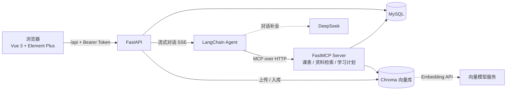

# 校园课程智能助手

面向校园场景的课程问答与学习管理平台。学生在同一个界面里查课表、检索课程资料、让 AI 助手直接回答问题并生成学习计划；管理员负责课程、课表与课程资料维护。

助手不是简单的聊天壳：课程资料会先切分、向量化入库，提问时按语义检索再交给大模型作答；课表查询与学习计划保存则通过 MCP 工具完成，用户身份由 JWT 决定，模型无法越权读写他人数据。

## 功能特性

| 模块 | 说明 |
| --- | --- |
| 账号与权限 | 注册、登录、JWT 鉴权，`admin` / `student` 角色隔离；管理员可维护用户 |
| 课程与课表 | 课程的增删改查；课表按班级/日期维护，学生只看自己的课表 |
| 课程资料 | `txt / md / pdf / docx` 批量上传、在线预览、重新入库、删除；入库失败整批回滚 |
| 资料问答 | 文档切分后写入 Chroma，按语义检索 Top-3 片段作答并标注来源文件 |
| 智能助手 | LangChain Agent 编排，支持多轮对话，SSE 流式输出思考状态、工具调用与回答 |
| 学习计划 | 支持手写保存，也支持对话生成后确认保存；按用户隔离，可删除 |
| 个人中心 | 头像上传、资料修改、密码修改 |

## 技术栈

| 层次 | 选型 |
| --- | --- |
| 后端 | Python 3.12、FastAPI、SQLAlchemy 2.0、Pydantic v2 |
| 数据库 | MySQL 8.0 |
| 检索增强 | LangChain、langchain-chroma、Chroma、BAAI/bge-m3（向量模型） |
| 智能体 | LangChain Agent、LangGraph、FastMCP、DeepSeek |
| 前端 | Vue 3、Vite、Element Plus、Axios、marked + DOMPurify |
| 鉴权 | JWT（PyJWT）、bcrypt |

## 系统架构



一次提问的链路：

1. 前端携带 JWT 调用 `/api/chat/stream`，同时生成 `X-Chat-Turn-Id`
2. 后端把用户问题与历史交给 Agent，Agent 判断是否需要调用工具
3. 需要时通过 MCP 调用课表查询 / 资料检索 / 学习计划保存，请求头里的身份信息由后端透传
4. 事件按 `status → tool_start → tool_end → token → done` 顺序流式返回，前端边收边渲染
5. 同一轮对话只允许写入一条学习计划（请求头 + 数据库唯一约束双重去重）

## 快速开始

### 环境要求

- Python 3.12+
- Node.js 22 LTS 或更高（`^22.18.0 || >=24.12.0`）
- MySQL 8.0+

### 1. 初始化数据库

```sql
CREATE DATABASE campus_course_agent DEFAULT CHARACTER SET utf8mb4 COLLATE utf8mb4_unicode_ci;
```

```powershell
mysql -u root -p campus_course_agent < sql/backend.sql
```

`sql/backend.sql` 会创建 `users` 表并写入初始账号。脚本开头有 `DROP TABLE IF EXISTS users`，不要在已有正式数据的库上重复执行。

### 2. 配置并启动后端

```powershell
cd backend
python -m venv .venv
.\.venv\Scripts\Activate.ps1
pip install -r requirements.txt
```

复制 `.env.example` 为 `.env`，填入真实配置：

```env
DATABASE_URL=mysql+pymysql://root:密码@127.0.0.1:3306/campus_course_agent
JWT_SECRET_KEY=请换成足够长的随机字符串
JWT_EXPIRE_HOURS=24
JWT_ALGORITHM=HS256

LLM_BASE_URL=https://api.deepseek.com
LLM_API_KEY=替换为你的对话模型密钥
LLM_MODEL_NAME=deepseek-flash
AGENT_RECURSION_LIMIT=14

EMBEDDING_API_KEY=替换为你的向量模型密钥
EMBEDDING_BASE_URL=https://api.siliconflow.cn/v1
EMBEDDING_MODEL=BAAI/bge-m3
CHROMA_COLLECTION=course_docs
CHROMA_HOST=127.0.0.1
CHROMA_PORT=8002
```

启动接口服务：

```powershell
uvicorn app.main:app --reload --host 127.0.0.1 --port 8000
```

健康检查 <http://127.0.0.1:8000/>，接口文档 <http://127.0.0.1:8000/docs>。

### 3. 启动向量库

```powershell
chroma run --host 127.0.0.1 --port 8002
```

首次上传课程资料时会自动创建集合，向量数据持久化在本地。更换向量模型后需要清空集合重新入库，否则查询维度不匹配。

### 4. 启动 MCP 服务

另开一个终端，在 `backend` 目录、激活虚拟环境后执行：

```powershell
python mcp_server.py
```

默认监听 `127.0.0.1:8001`，路径 `/mcp`，可通过 `.env` 中的 `MCP_HOST` / `MCP_PORT` 调整。对话功能依赖该进程，未启动时问答会提示工具服务不可用。

### 5. 启动前端

```powershell
cd frontend
npm install
npm run dev
```

访问 <http://127.0.0.1:5173>。前端通过 `frontend/.env.development` 指定接口地址（默认 `http://127.0.0.1:8000`），Vite 已配置 `/api`、`/uploads` 代理。

### 初始账号

| 用户名 | 密码 | 角色 |
| --- | --- | --- |
| `admin` | `admin` | 管理员 |
| `aaa` | `123` | 学生 |
| `bbb` | `123` | 学生 |

注册入口创建的用户默认为学生，管理员权限需要在用户管理中调整。

## 主要接口

| 方法 | 路径 | 说明 |
| --- | --- | --- |
| POST | `/api/auth/register` | 注册 |
| POST | `/api/auth/login` | 登录并返回 Token |
| GET / PUT | `/api/user/me` | 当前用户信息 |
| PUT | `/api/user/password` | 修改密码 |
| GET / POST / PUT / DELETE | `/api/course` | 课程维护 |
| GET / POST / PUT / DELETE | `/api/schedule` | 课表维护 |
| GET / POST / DELETE | `/api/study-plans` | 学习计划 |
| GET / POST | `/api/documents` | 资料列表 / 批量上传 |
| POST | `/api/documents/{id}/reindex` | 重新入库 |
| GET | `/api/documents/{id}/preview` | 纯文本预览 |
| POST | `/api/chat/stream` | 流式对话（SSE） |

所有接口统一返回 `{ code, message, data }`，业务异常返回 HTTP 200 并在 `code` 中标记错误。

## 目录结构

```text
scaffold/
├── sql/backend.sql              # 表结构与初始账号
├── backend/
│   ├── app/
│   │   ├── api/                 # 路由
│   │   ├── services/            # 业务逻辑（文档入库、RAG、Agent）
│   │   ├── models/              # ORM 模型
│   │   ├── schemas/             # 请求 / 响应模型
│   │   ├── common/              # 统一返回与异常处理
│   │   ├── dependencies/        # 鉴权依赖
│   │   └── config.py            # 配置与路径常量
│   ├── mcp_server.py            # FastMCP 工具服务
│   ├── data/kb/                 # 课程资料归档
│   ├── uploads/                 # 头像等公开文件
│   └── requirements.txt
├── frontend/
│   └── src/
│       ├── api/                 # 接口封装
│       ├── views/               # 页面
│       ├── layouts/             # 布局
│       └── utils/               # Token、用户状态
└── README.md
```

## 设计说明

- **入库可回滚**：一次上传多个文件时，任一文件解析或向量化失败，数据库记录与本批文件一起清理，不会留下"有记录但检索不到"的脏数据。
- **检索结果可追溯**：回答中标注片段来源文件，便于核对；"检索服务不可用"与"没有检索到内容"分开提示，避免把故障当成没查到。
- **身份不从模型传参**：MCP 工具中的 `user_id` 一律由请求头 JWT 解析，模型无法通过参数指定他人。
- **写入幂等**：同一轮对话通过 `X-Chat-Turn-Id` 加唯一约束保证学习计划只落一条。
- **权限边界**：学生只能读写自己的课表、学习计划；课程资料对所有登录用户开放检索。

## 安全说明

- `.env` 含数据库密码与模型密钥，已在 `.gitignore` 中排除，只提交 `.env.example`
- 生产部署请更换 `JWT_SECRET_KEY`、数据库密码，并把 CORS 白名单改为实际域名
- 上传接口限制扩展名与单文件大小，`DOC/XLS/ZIP` 仅作为附件保存，不参与文本解析

## 常见问题

| 现象 | 排查 |
| --- | --- |
| 启动报数据库连接错误 | MySQL 是否启动、库是否创建、`DATABASE_URL` 账号密码是否正确 |
| 登录后接口 401 | 后端是否启动；本地是否有过期 Token，清除站点数据后重新登录 |
| 问答一直提示工具服务不可用 | `mcp_server.py` 是否在 8001 端口运行 |
| 资料上传后检索不到 | Chroma 是否运行在 8002；该文件是否入库成功；换过向量模型需重新入库 |
| 新注册账号看不到用户管理 | 正常，新用户为 `student`，管理员需在用户管理中调整角色 |
